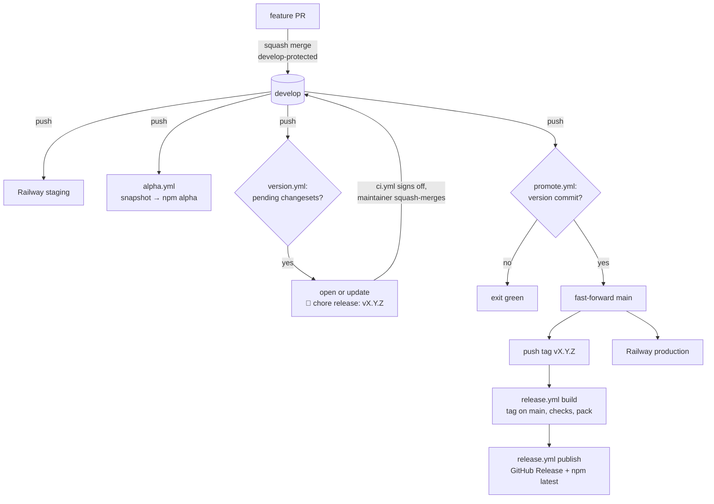

# Delacour UI — Monorepo

A Bun workspace holding `@delacour/react-native-ui`, a React Native component library,
and the Expo app that renders it. Nothing here ships to a user; the library is
the product.

## Workspaces

| Path | Package | What it is |
| --- | --- | --- |
| `packages/react-native-ui` | `@delacour/react-native-ui` | **The product.** A React Native component library. Ships raw `.tsx`, no build step |
| `packages/react-native-charts` | `@delacour/react-native-charts` | The headless charting engine `react-native-ui`'s `Chart` skins — Skia, no tokens, no `className` |
| `packages/react-native-bottom-sheet` | `@delacour/react-native-bottom-sheet` | The headless bottom sheet engine `react-native-ui`'s `BottomSheet` skins — Gesture Handler, Reanimated, keyboard-controller, teleport; no tokens, no `className` |
| `packages/design-system` | `@delacour/design-system` | The customizer's axes, the resolver, the preset codec and the CSS emitters |
| `packages/cli` | `delacour` | The CLI that copies the library's source into someone else's repo, and the builder for the `registry/` it reads |
| `apps/playground` | `@delacour/playground` | Expo app — the library's harness and gallery |
| `apps/web` | `@delacour/web` | The documentation site — TanStack Start + Fumadocs, deployed on Railway |
| `packages/biome-config` | `@delacour/biome-config` | Lint and format rules, for everything |
| `packages/brand` | `@delacour/brand` | The Delacour mark — master art plus the geometry every rendering reads |
| `packages/skills` | `@delacour/skills` | The agent skill the CLI installs and the docs site serves |
| `packages/tsconfig` | `@delacour/tsconfig` | Shared TypeScript configs |
| `packages/types` | `@delacour/types` | Shared utility types — `Result` and its constructors |

Each has its own `AGENTS.md`. **Read the one for the package you are editing** —
`packages/react-native-ui/AGENTS.md` is the substantial one, and it indexes a further
file per component.

## Commands

Run from the repo root; turbo fans each out across every workspace.

```bash
bun install                # postinstall wires the prek hooks
bun run dev                # turbo dev — the playground via `warden dev ios`, in practice
bun run typecheck          # tsc --noEmit everywhere
bun run check              # Biome lint + format
bun run lint               # lint only
bun run fmt                # format only
bun test                   # unit tests
bun run previews           # recapture component preview media from a simulator
bun run previews:verify    # recapture a selection, pixel-diff it against origin/develop, write a report
bun run previews:affected  # which components' preview media this branch made stale, and the command to recapture them
bun run previews:pr-table  # the before/after table of this branch's recaptured media, for the pull request body
bun run signoff            # run the merge gate's checks locally and sign off the open pull request
bun run cli:link           # build the CLI and link it, so `delacour` on PATH is this tree
bun run cli:unlink         # put back whatever `delacour` was before cli:link
bun run nuke               # delete every node_modules and reinstall from scratch
```

Two generators live in the apps rather than at the root, because each writes into its own
workspace. Both read `packages/brand` and both commit their output:

```bash
cd apps/playground && bun run icons   # launcher, adaptive and tinted app-icon PNGs
cd apps/web        && bun run icons   # favicons, PWA icons, apple-touch-icon
```

`previews` is the odd one out: it drives an iOS simulator through warden, so it needs a Mac with
Xcode and `warden` on the PATH, and it is deliberately **not** part of `build`. Its output — `apps/web/public/previews/**` and
`apps/web/src/previews/manifest.ts` — is committed, which is what lets the docs site deploy on a
machine with no simulator. See [apps/playground/AGENTS.md](apps/playground/AGENTS.md#capturing-preview-media).

Turbo caching is **off** for every task but `build` (`cache: false` in
`turbo.jsonc`), so a run always reflects the tree as it is now.

## Branches

Two long-lived branches, and they move differently:

| Branch | Holds | Moves by |
| --- | --- | --- |
| `develop` | Everything merged — where work lands | A squash-merged pull request — the version pull request `version.yml` opens included |
| `main` | The last release — the repository's default branch and front page | `promote.yml` fast-forwarding it to the version commit |

`main` is the default branch so that anyone reaching the repository sees what was last published.
GitHub also offers the default branch as the base of every new pull request, and it has no setting
to offer a different one, so `.github/workflows/retarget-pr.yml` moves any pull request opened
against `main` to `develop` — from a branch in this repository; a fork's runs no workflow without a
maintainer's approval, so a maintainer retargets it by hand. Open against `develop` in the first place — `gh pr create --base develop`,
or `git config branch.<name>.gh-merge-base develop` once per branch — and branch off `origin/develop`,
not `main`.

`.github/rulesets/develop.json` (`develop-protected`) is the merge gate: it blocks force-pushes and
deletion, requires linear history, and requires a pull request whose `signoff` statuses are green
(see [Signoff](#signoff)) and whose review threads are resolved. Squash is the only merge method.

`.github/rulesets/main.json` (`main-protected`) is release-only: it blocks deletion and non-fast-forward
pushes, requires linear history, and restricts updates to its bypass list — repository admins and
the release app. There is no pull request rule on it, because nothing reaches `main` by pull
request. The one routine update is `promote.yml`'s fast-forward, made with the release app's
token, which is why the app is on that list. Because `develop` only takes squash merges and `main` only fast-forwards,
`main` is always an ancestor of `develop`; a hand-made commit on `main` breaks that, and the next
release then fails at the push.

Approvals are **not** required — a sole maintainer cannot approve their own pull request — so the
gate is signoff plus resolved conversations. A worktree is therefore a feature branch: opening a pull
request is the only way in. Repository admins can bypass in an emergency, and the audit log records
it when they do.

The branch does **not** have to be up to date with `develop` (`strict_required_status_checks_policy`
is off). With it on, every merge staled every other open pull request's signoff, and a batch of
pull requests became a serial train of rebase, re-sign-off, merge. The cost is that a squash lands a
tree nobody signed off — the head plus whatever `develop` gained meanwhile. Git conflicts still block
the merge; a semantic conflict between two independently green pull requests does not. When two
pull requests touch the same code, rebase the second and sign it off again before merging it.

GitHub does not apply the rulesets from those files; the files are the reproducible copy of what was
applied. To change protection, edit the JSON, apply it, and commit both in the same change:

```bash
REPO=delacournz/delacour-ui
for FILE in main develop release-tags; do
  NAME=$(jq -r .name ".github/rulesets/$FILE.json")
  ID=$(gh api "repos/$REPO/rulesets" --jq ".[] | select(.name==\"$NAME\") | .id")
  if [ -n "$ID" ]; then
    gh api --method PUT "repos/$REPO/rulesets/$ID" --input ".github/rulesets/$FILE.json"
  else
    gh api --method POST "repos/$REPO/rulesets" --input ".github/rulesets/$FILE.json"
  fi
done
```

The `POST` branch is not decoration: the files were once committed and never applied, `develop` ran
with no ruleset at all, and the loop as first written could only update one that already existed.
Check `gh api "repos/$REPO/rulesets"` after applying.

## Signoff

Pull requests into `develop` are gated on **local** CI. The checks run on the machine that authored
the change and [`basecamp/gh-signoff`](https://github.com/basecamp/gh-signoff) writes commit
statuses for them, which `develop-protected` requires. Every one of these checks had already run
there once — through prek, `bun test`, or the agent that wrote the change — and running them again
on billed runners for every push was the bulk of the Actions spend.

```bash
gh extension install basecamp/gh-signoff   # once per machine (the wrapper does it if missing)
bun run signoff -- --dry-run               # the plan for this branch's diff; runs and writes nothing
bun run signoff                            # run the checks, write the statuses, post the report
bun run signoff -- --only typecheck,test --skip registry --no-comment --concurrency 1
```

`scripts/signoff.ts` refuses a dirty tree, an unpushed `HEAD` and a branch with no open pull request,
plans the checks from the diff against the pull request's base, runs each one through turbo, and
writes `signoff/<check>` for every check that passed, then the bare `signoff` umbrella **last** —
and only when something ran and nothing failed. It posts (or edits in place) one comment on the
pull request naming the `gh` user, the runner — **Claude Code** when an agent ran it — and every
check's duration and skip reason.

The checks are defined once, in `scripts/signoff-checks.ts`:

| Context | Required | Runs | Command |
| --- | --- | --- | --- |
| `signoff/typecheck` | yes | always | `turbo typecheck` |
| `signoff/check` | yes | always | `turbo check` |
| `signoff/test` | yes | always | `turbo test test:release test:scripts` |
| `signoff/build` | yes | always | `turbo build --filter=@delacour/web` |
| `signoff/registry` | no | the library, CLI, skills, registry or a manifest changed | `turbo registry:build gen-install gen-skill`, `git diff --exit-code`, `turbo verify:expo -- --no-install` (both layouts) |
| `signoff/tests` | no | anything but markdown changed | `verify:expo --tests <runner> --dir .verify/tests-<runner>` for `bun`, `jest` and `vitest`, at once — every component's suites copied into an installed app and run by that runner |
| `signoff` | yes | — | the umbrella, written only when every applicable check passed |

`registry`'s two runs share `packages/cli/.verify/app` and hold its pool lock. `tests` runs its three
runners at the same time, each in its own `--dir` with its own CLI build and packed engines beside
it, so it shares nothing with `registry` or with itself and needs no lock. `tests` installs from npm and takes minutes; it is path-gated on everything but
markdown rather than `always`, which keeps the ruleset's required list unchanged — it gates through
the umbrella like `registry` does, and `ci.yml`'s `copied-tests` job runs it for the release pull
request and a dispatched signoff.

Only always-on checks are required. A ruleset's required list is static, so a required context
that never arrives leaves a pull request unmergeable forever; `registry` gates **transitively**
instead, because the umbrella is withheld when a check the diff needed did not pass.
`scripts/signoff.test.ts` pins `REQUIRED_CONTEXTS` against `.github/rulesets/develop.json`, so the
two cannot drift.

**A status binds to a SHA.** Push again — or press **Update branch** — and the signoff drops; run
it again. Never write a status for a check that did not
run, and never weaken a check to get one: bare `gh signoff` writes green without running anything,
and is break-glass only, by a maintainer, said so in the pull request.

When a check genuinely cannot run on a laptop, dispatch the workflow instead — it runs the real
checks and, given a SHA, writes the same statuses from CI:

```bash
gh workflow run ci.yml --ref "$(git branch --show-current)" -f signoff-sha="$(git rev-parse HEAD)"
```

The version pull request is the one pull request signed off in CI, automatically — see below.

## CI

`.github/workflows/ci.yml` is no longer the gate for an ordinary pull request. It runs the same
checks — `typecheck`, `check (lint + format)`, `test`, `build`, `registry` and `verify-expo` — in
three cases only:

| Trigger | Why |
| --- | --- |
| `pull_request` from `changeset-release/develop` | No person authors the version pull request, so nobody is at a laptop to sign it off. Its final `signoff` job writes the five required statuses for the head SHA it tested. Every job is gated by `if:` to that head branch, so an ordinary pull request starts the workflow and bills nothing |
| `workflow_dispatch` | The escape hatch above. With `signoff-sha`, a green run writes the statuses; blank is a report |
| push to `release/playground/*` | Advisory — see [apps/playground/AGENTS.md](apps/playground/AGENTS.md#eas) |

It does not run on push to `develop` or `main`. A commit on `develop` is the squash of a pull request
signed off at its head; the merged tree can differ from that head when `develop` moved in between
(see [Branches](#branches)), and the next pull request's signoff covers it. `main` only
fast-forwards to a release commit, whose pull request `ci.yml` signs off on its own head. Railway does not wait on check suites, so no deploy depends on
one either. `scripts/signoff.test.ts` fails if `ci.yml` regains a push to `develop` or an ungated
pull request job.

`verify-expo` — the CLI against a real, npm-installed Expo app — is not part of local signoff: it
installs from the registry and takes minutes. It runs on the version pull request, before anything
reaches npm, and on dispatch.

Every job runs on a [Namespace](https://namespace.so) runner, never a GitHub-hosted label:
`namespace-profile-linux-small` for Linux work — `namespace-profile-linux-medium` for `typecheck`,
whose tsc runs were OOM-killed on the small profile — `namespace-profile-mac-small` for any job that
needs macOS (Xcode, a simulator), and `namespace-profile-windows-small` for any job that needs
Windows. Nothing needs macOS or Windows today, so those two profiles are unused.
The `ubuntu-latest` / `macos-*` / `windows-*` labels are not to be reintroduced — with one exception, below.

The exceptions are `release.yml`'s `publish` job and `alpha.yml`, which stay on `ubuntu-latest`. npm's trusted
publishing generates a sigstore provenance attestation and verifies it against the runner, and
sigstore only attests GitHub-hosted runners: on a Namespace runner every `npm publish` fails
with `E422 … Unsupported GitHub Actions runner environment: "self-hosted"`. Moving it back to
Namespace means either `--provenance=false` (OIDC without the attestation) or an npm token, and
neither is worth one short job per release.

The required contexts carry no `integration_id` in the ruleset, on purpose: a local signoff is
written through the GitHub CLI's OAuth app and the version pull request's through GitHub Actions,
and both have to satisfy the same rule.

Socket Security posts two further checks. They stay advisory on purpose: requiring a third-party app
would couple the merge gate to a vendor's uptime.

## Dependency versions

Shared native and React versions are pinned once, in the root `package.json`
`workspaces.catalog`, and referenced as `catalog:` from each package:

```
@legendapp/list  react 19.3.0  react-native 0.88.0
react-native-gesture-handler ~3.3.0  react-native-keyboard-controller 1.22.7  react-native-reanimated 4.7.1
react-native-safe-area-context ~5.10.1  react-native-screens ~4.30.0  react-native-skia 3.7.3
react-native-svg 15.16.0  react-native-worklets 0.13.0
```

Every version here is the one Expo SDK 58 bundles. That is the rule, not a coincidence: `expo
install` and `expo-doctor` both check against it, and a native module a minor ahead of the SDK
fails at the linker rather than at install.

`react-native-skia` is the one exception. SDK 58 bundles `@shopify/react-native-skia` 2.14, the last
release under that name; v3 moved to `react-native-skia` and draws through Graphite, so `expo install`
and `expo-doctor` flag it — that is expected. v3 needs Android API 26 (Vulkan 1.1), which the
playground sets through `expo-build-properties`.

A native module the SDK does not bundle is **not** catalogued, because the catalog is that list
and nothing else. `react-native-pulsar` (`^1.7.0`), `react-native-teleport` (`^1.2.2`) and
`@maplibre/maplibre-react-native` (`^11.5.0`) are the three today; each workspace that needs one
repeats the range verbatim, and a bump is a search for the range rather than a catalog edit.

`@types/react` is catalogued for the same reason a native module is, and it was added after the
proof: four packages declared three different ranges (`^19.2.0`, `~19.2.2`, `^19.2.18`), so two
copies were always installed and only bun's hoisting order decided which one landed at the root.
Rename a package and that order changes — `packages/react-native-ui` then compiled against a different
`@types/react` from the app, every `ComponentRef<typeof Animated.View>` collapsed to `never`, and
`tsc` blamed `pressable.tsx`.

**Bump a version in the catalog, never in a package.** Two versions of a native
module register twice and break at runtime — which is also why `react-native-ui`
declares every native module as a **peer** dependency rather than a dependency.

## `linker = "hoisted"` is load-bearing

`bunfig.toml` sets it, and Metro is the reason:

> Metro resolves modules by walking `node_modules` directories and cannot see
> through Bun's default isolated layout (packages hidden under
> `node_modules/.bun`). A hoisted, flat `node_modules` is what React Native
> tooling expects; without this, Metro fails to resolve `@expo/metro-runtime`
> and the bundle never builds.

Do not remove it, and do not switch a package to an isolated install. Even
hoisted, Bun materialises a second copy of some native modules under the app,
which is why `apps/playground`'s `metro.config.js` pins twelve of them — plus `react` and
`culori`, for a single copy of each — to the workspace-root copy and its `tsconfig.json` pins
`react-native` the same way. `react-native-teleport`, outside the catalog, is one of the twelve.

## `trustedDependencies`

None. `@shopify/react-native-skia` 2 needed one — its `postinstall` copied the prebuilt
`.xcframework`s into its own `libs/`, and blocked, the iOS build failed at link time. `react-native-skia`
3 ships its binaries as npm packages (`react-native-skia-graphite-apple-*`, `react-native-webgpu-dawn`)
and runs no install script, so the list went with it.

## Releases

Four packages reach npm — `delacour` (the CLI), `@delacour/react-native-ui`, `@delacour/react-native-charts`
and `@delacour/react-native-bottom-sheet`.
Everything else in the workspace is `private: true`, which is the only thing stopping
`changeset publish` from putting `@delacour/tsconfig` and friends on the registry the first time
it runs.

**Libraries are scoped; the CLI is not.** The `@delacour` org on npm is ours, so every library that
publishes lives under it, named for what a consumer installs rather than for its workspace folder —
`packages/react-native-ui` publishes as `@delacour/react-native-ui`, because the thing in the import is
React Native and the folder name is an internal detail nobody types. The CLI stays the bare `delacour` because it is typed, not imported:
`bunx delacour add button` is the whole point of it. Moving a private package to published needs no
rename, only `private: true` removed and the manual first publish below.

The two libraries were published as `delacour-react-native-ui` and `delacour-react-native-charts`
while the org belonged to someone else. Those names are deprecated on npm with a pointer here and
take no further versions — do not publish to them.

`@delacour/react-native-charts` is public because it has to be: `react-native-ui` ships raw `.tsx`, so the
`import … from "@delacour/react-native-charts"` in `chart.tsx` is in the published tarball and gets resolved by
a stranger's Metro. It is an **optional peer** of `react-native-ui` rather than a dependency — a
dependency may be nested, two copies mean two chart contexts, and a correctly-nested
`<Chart.Line>` then throws "must be used inside a `<Chart>`" from inside a `<Chart>`.
`@delacour/react-native-bottom-sheet` is public, and an optional peer, for exactly the same reasons:
`bottom-sheet.tsx` imports it, and two copies would be two sheet contexts.

Releases are driven by [Changesets](https://github.com/changesets/changesets). A change that
should ship adds one:

```bash
bun run changeset          # pick packages, pick a bump, describe it
```

Commit that markdown file alongside the change.

**The four published packages share one version.** They are a single `fixed` group in
`.changeset/config.json`, so a changeset naming any of them moves all four — the CLI included,
changed or not. `delacour@x.y.z` therefore always ships beside `@delacour/react-native-ui@x.y.z` and
the two engines at `x.y.z`, and a release is one tag, `vx.y.z`. `.github/changeset-config.test.ts`
fails if the group and the published set drift apart.

From there the packages ship on two lines:

| Line | npm dist-tag | Version | Published by | When |
| --- | --- | --- | --- | --- |
| alpha | `alpha` | `x.y.z-alpha.<datetime>` | `.github/workflows/alpha.yml` | Every push to `develop` that carries a pending changeset |
| stable | `latest` | `x.y.z` | `.github/workflows/release.yml` | The `vx.y.z` tag `promote.yml` pushes when the version pull request is merged |

### The flow

Three workflows, one hop each, copied from warden's:

```
 feature PR ─▶ develop ─▶ version.yml ─▶ "🔖 chore(release): vX.Y.Z" PR ─▶ develop
                                                                           │
                              promote.yml ◀────────── squash merge ────────┘
                              │ fast-forward main, push tag vX.Y.Z
                              ▼
                              release.yml (tag push)
                              │ build: tag on main? versions = tag? checks, registry, CLI, npm pack
                              │ publish: GitHub Release + npm publish (charts, bottom-sheet, ui, cli)
                              ▼
                              npm @latest      main ─▶ Railway production ui.delacour.co.nz

  every push to develop ─▶ alpha.yml (npm @alpha) and Railway staging ui.staging.delacour.co.nz
```



| Workflow | Trigger | Does |
| --- | --- | --- |
| `version.yml` | push to `develop` | With pending changesets, runs `bun run version` (`changeset version` + `bun install --lockfile-only`) on `changeset-release/develop` and opens or updates the version pull request. Skips the version commit itself |
| `promote.yml` | push to `develop` | When the push is the version commit, fast-forwards `main` to it and pushes the annotated tag `vX.Y.Z`. Runs no repo code |
| `release.yml` | push of a `v*` tag | `build` refuses a tag not on `main` or not matching every published `package.json`, runs typecheck/check/test, checks the registry, builds the CLI and `npm pack`s all four. `publish` cuts the GitHub Release and `npm publish`es each tarball not already on npm |

### Alpha: every merge

`alpha.yml` runs `.github/changeset-alpha.ts` on every push to `develop`. With no pending changeset
it exits green — a docs-only merge, or the version commit itself. Otherwise it runs
`changeset version --snapshot alpha`, which gives all four packages (they are `fixed`) the version
the next release would give them plus an `-alpha.<datetime>` suffix — `useCalculatedVersion` and
`prereleaseTemplate` in `.changeset/config.json` set that shape. The suffix is a 14-digit number, so
each snapshot sorts after the one before it. The bump is never committed: the runner's tree is
thrown away, and the changesets stay pending for the release.

Each unpublished snapshot then goes to npm with `npm publish --tag alpha`, directly. `latest` is
never touched. No git tag and no GitHub Release is cut: a snapshot is a build, not a release.

After a stable release `alpha` still names the last snapshot, which is older than the new
`latest`, until the next merge with a changeset publishes a new one.

### Stable: merge the version pull request

`version.yml` keeps one pull request open from `changeset-release/develop` into `develop`, titled
**🔖 chore(release): vX.Y.Z** — the version merging it will ship. `changeset status` names that
version before `changeset version` runs, so the title and the commit message carry it, and the
squash lands on `develop` as `🔖 chore(release): vX.Y.Z (#n)`. With nothing pending the title falls
back to `version packages`, which only ever names the run that closes the pull request.

It holds what `changeset version` produces — every pending changeset consumed into stable versions
and changelogs, and `bun.lock` regenerated to match. Each merge to `develop` rebuilds it on top of the
new tip, so it always describes the release that merging it would cut. It is an ordinary pull
request, except that `ci.yml` signs it off rather than a person: the app's push starts `ci.yml` on
`pull_request`, the checks plus `verify-expo` run, and its `signoff` job writes the statuses.

**Merging it is the release.** `promote.yml` recognises the version commit by three facts, not by its
subject: `packages/cli/package.json`'s version differs from the pre-push tip, no changeset is
pending, and tag `vX.Y.Z` does not exist yet. It fast-forwards `main` (never forced — if `main` is not
an ancestor it fails, because a force would rewind what Railway serves) and pushes the tag. The tag
starts `release.yml`.

**Every step is safe to re-run.** `promote.yml` skips a version whose tag exists and its `main` push
is a no-op once `main` is there. `release.yml`'s GitHub Release step replaces assets on a release that
already exists, and its npm step skips any `name@version` npm already serves, so
`gh run rerun --failed` finishes a partial publish.

Fast-forwarding `main` is also what deploys `ui.delacour.co.nz`, so the production docs move with
each release and not with each merge, and land with the npm publish the same tag starts.

### The CLI follows its own line

A CLI reads the registry at the commit it was built from, so an alpha CLI can hand over components
that use an API only the alpha packages have. `packages/cli/src/project/channel.ts` reads the CLI's
own version: an `-alpha` build installs Delacour packages as `@alpha`, a stable one installs them
untagged from `latest`. The documented commands are `bunx delacour@latest` and a bare
`bun add @delacour/react-native-ui`; `@alpha` is how a consumer opts into the snapshot line.

### npm authentication

**Both workflows authenticate with OIDC — there is no npm token.** Each package has two trusted
publishers on npmjs.com, bound to this repository and a workflow filename:

| Workflow | Environment | Allowed action |
| --- | --- | --- |
| `alpha.yml` | — | `npm publish` |
| `release.yml` | `release` | `npm publish` |

The binding is the filename (and, for `release.yml`, the environment): rename either and its
publishes are refused until the publisher is recreated. There is no staging and no 2FA approval —
merging the version pull request is the approval, as in warden. The `release` environment has no
required reviewer; its deployment branch policy limits it to `v*` tags.

`release.yml`'s `publish` job never installs or runs repo code: `build` packs the tarballs with a
read-only token and no registry secret, and `publish` uploads them byte for byte with
`--ignore-scripts`, engines before `@delacour/react-native-ui` (which peers on both) and the CLI last.
Both npm jobs run on `ubuntu-latest` because sigstore only attests GitHub-hosted runners.
`bun publish` cannot do any of this: it has no OIDC or provenance support, so the publish call is
npm's even though install and build are Bun's.

**Only the release app may create `v*` tags.** A tag push publishes, so `.github/rulesets/release-tags.json`
(`release-tags`) restricts creating, moving and deleting them to repository admins and the app, and
`release.yml` refuses a tag whose commit is not on `main`.

**The GitHub side is a GitHub App, not a PAT.** `version.yml` and `promote.yml` mint a short-lived
installation token from the `delacour-release` app with `actions/create-github-app-token`. That
token does what `GITHUB_TOKEN` cannot. It pushes the version pull request's branch: a push made with
`GITHUB_TOKEN` starts no workflows, so `ci.yml` would never run on that pull request, and its
required `signoff` statuses would never be written. It fast-forwards `main`, which `main-protected`
lets only its bypass list update — the app is on it, as an `Integration` actor whose `actor_id` is
the app id. And it pushes the tag, which has to start `release.yml`.

An app rather than a PAT because a fine-grained PAT expires within a year and belongs to one
person; the app does neither, and its token lasts an hour. There is deliberately no fallback to
`GITHUB_TOKEN`: the first release run under the old flow fell back to it silently, got as far as the
push to `main`, and was refused there with a ruleset error that named neither the missing secret
nor the token.

The app is owned by the `delacournz` organisation, installed on this repository only, with no
webhook and three repository permissions, all read/write:

| Permission | For |
| --- | --- |
| Contents | Pushing `changeset-release/develop`, `main` and the tags |
| Pull requests | Opening and updating the version pull request |
| Workflows | Either push, whenever the commits it carries touch `.github/workflows/**` — GitHub refuses those from a token without it |

Its id and key reach the workflow as a variable and a secret:

```bash
gh variable set RELEASE_APP_ID --repo delacournz/delacour-ui --body <app id>
gh secret set RELEASE_APP_PRIVATE_KEY --repo delacournz/delacour-ui < <downloaded>.private-key.pem
```

Rotating the key is generating a new one on the app's settings page, setting the secret again and
deleting the old key there. Uninstalling the app, or removing it from `main-protected`'s or
`release-tags`' bypass list, stops every release at `promote.yml`.

The first publish of a package has to be manual: npm can only bind a trusted publisher to a package
that already exists. Publish it by hand once (`npx npm@latest publish --access public --tag alpha`,
2FA), then on npmjs.com under **Settings → Trusted publishers** bind GitHub Actions to repository
`delacournz/delacour-ui` twice — workflow `alpha.yml`, and workflow `release.yml` with environment
`release` — and add it to the `fixed` group, `release.yml`'s pack and publish lists and
`.github/changeset-config.test.ts`.

`verify:expo` does not wait for that: it packs each
workspace package a registry item depends on (`@delacour/react-native-charts` for `chart`,
`@delacour/react-native-bottom-sheet` for `bottom-sheet`) and adds the tarball to the scaffolded app
before `add`, so the check covers this branch's engines rather than whatever npm last served — and
passes before a package exists there at all.

The registry the published CLI reads is pinned to the **commit** being released, not the tag — a
SHA is immutable. See `packages/cli/AGENTS.md`.

## Deployment

`apps/web` is deployed on Railway as a Docker image built from
[`apps/web/Dockerfile`](apps/web/Dockerfile) (repo-root context, trimmed by the root `.dockerignore`).
The service itself — builder, `dockerfilePath`, watch patterns, variables, domains — is declared in
`delacournz/delacour-monorepo`'s `apps/ui/infra/railway.ts`, not here: there is no `railway.json` or
`railpack.json` in this repo, and adding one would fight that config. Any variable the build reads
must be an `ARG` in the Dockerfile, or the build never sees it.

| Branch | Environment | Host |
| --- | --- | --- |
| `develop` | staging — every merge | `ui.staging.delacour.co.nz` |
| `main` | production — every release | `ui.delacour.co.nz` |

`bun run previews` must never run in CI or in a deploy — it drives an iOS simulator and needs a Mac
with Xcode. Its outputs are committed so the site builds on a simulator-less runner.

`apps/web` also serves the deep-link association files — `/.well-known/apple-app-site-association`
and `/.well-known/assetlinks.json` — for both hosts. iOS reads its copy when the app is installed
and caches it, so **the docs deploy has to land before a playground build is installed**, or that
binary intercepts nothing until it is reinstalled.

`apps/playground` ships through EAS instead, from `apps/playground/.eas/workflows` — dev clients on
demand, and a push to `release/playground/x.y.z` running `release:prod`, which takes its version
from the branch name, ships an OTA update when the fingerprint already has a binary, and only
builds and submits when it does not, tagging every binary and update it ships on GitHub. It is a separate
pipeline from the docs site and shares nothing with it; the details, including why none of those
workflows set a `working_directory`, are in
[apps/playground/AGENTS.md](apps/playground/AGENTS.md#eas).

## Hooks

`prek` installs on `postinstall`. Two stages, configured in
`.pre-commit-config.yaml`:

| Stage | Runs |
| --- | --- |
| pre-commit | `scripts/pre-commit-biome.ts` — Biome `check --write` on staged files, re-staging anything it fixed |
| pre-push | `bun run typecheck` across every workspace |

`@delacour/web#typecheck` depends on `@delacour/web#codegen` in `turbo.jsonc`, which is what
makes the pre-push hook usable at all: TanStack Router generates the gitignored
`apps/web/src/routeTree.gen.ts` during `vite build`, so on a fresh clone `tsc` used to fail with a
wall of `Property '_splat' does not exist on type 'never'` before anything had been built. The edge
is scoped to `apps/web` on purpose — no other workspace needs a build to typecheck.

A commit can therefore rewrite its own staged files. If a commit fails, the fix
is usually already applied and staged — re-read the diff before changing
anything.

## Patches

None. There was one — `patches/expo-modules-jsi@57.0.5.patch`, which declared
`retainRuntimeScheduler` / `releaseRuntimeScheduler` for Swift bridging — and
`expo-modules-jsi@57.1.0` ships those declarations itself, so it was removed
along with the `patchedDependencies` entry that applied it.

**A patch keyed to an exact version silently stops applying when the version
moves, and the lockfile is the only thing holding it still.** That is what
happened here: something already required `~57.1.0` while `bun.lock` still
pinned `57.0.5`, so every install reproduced the patched tree and no install
ever said the patch had become unnecessary. It surfaced only when a new
workspace package forced a re-resolve and `--frozen-lockfile` began failing.

If a patch comes back, pin the patched package explicitly rather than relying
on the lockfile to do it, and re-check the patch whenever the Expo SDK moves.

## Conventions

**TypeScript.** No `any` — type everything. Discriminated unions for type-based
shapes; `@delacour/types`' `Result` is the house example.

**Tests.** Write them first. Colocate as `{name}.test.ts` beside the source. Run
`bun test <path>` after each change and the related suites before committing.
`react-native-ui` can only test pure logic — React Native ships Flow-typed source Bun's
transpiler cannot parse — so behaviour that needs a renderer is verified in the
playground on a simulator instead.

**Files.** Kebab-case, enforced by Biome. The exception is `apps/playground/src/app`,
where Expo Router derives route names from filenames.

**JSX.** No comments inside markup — no `{/* … */}` in a render tree. The
explanation goes in the component's doc comment or above the `return`.

**Commits.** Gitmoji prefix, conventional type, package scope:

```
✨ feat(react-native-ui): add Tabs with a swipeable pager and a measured indicator
🐛 fix(react-native-ui): fade a Tabs separator only while the pager crosses it
🎨 style(react-native-ui): adjust Switch content text sizes
```

`✨ feat` · `🐛 fix` · `🔧 chore` · `📝 docs` · `🎨 style` · `♻️ refactor` ·
`✅ test` · `🚧 wip` · `👽️ types`. Commit messages end at their last real line —
no trailers. Pull requests target `develop`; `main` moves only on a release — see [Branches](#branches).

**Documentation is part of the change.** `react-native-ui`'s docs are updated in the
same commit as the code, and `bun test` fails by name for a component folder with
no `AGENTS.md`. That test exists because `Radio` shipped undocumented and nothing
caught it for fifteen commits.

**Screenshots are part of the change too.** A pull request that alters what
anyone sees carries them, and recaptures them in the same push that moves the
pixels — a body showing a control the branch no longer has is worse than a body
showing none, because nobody reads a pull request twice. For the docs site,
`cd apps/web && bun run screenshots` shoots the set; where the images go, and why
they are keyed to a commit rather than overwritten, is in
[apps/web/AGENTS.md](apps/web/AGENTS.md#pull-request-screenshots).

**A component that looks different is recaptured in the same branch, before the pull request
opens.** A demo's capture hash covers the demo, not the component it renders, so an incremental
`bun run previews` after a change to `button.variants.ts` re-captures nothing: the docs site goes on
showing the old Button, and every Dialog that renders one, until someone asks. The rule:

- **What triggers it.** A change under `packages/react-native-ui/src/components/<name>/`, its demos
  (`apps/playground/src/demos/<name>/`) or its spec (`apps/playground/e2e/previews/<name>.e2e.ts`),
  under `lib/`, `styles/` or `hooks/` that a component renders through, or in an engine
  (`packages/react-native-charts`, `packages/react-native-bottom-sheet`). `bun run previews:affected`
  walks the import graph from the diff and prints the components and the command.
- **What is exempt.** A change that cannot move a pixel: tests and fixtures, `AGENTS.md` and other
  markdown, types-only edits, comments, and logic no capture exercises (a callback's arguments, an
  accessibility label, an error message). The test is whether any captured demo would render
  differently; when unsure, recapture — an unchanged picture costs one run, a stale one ships.
- **The command.** `bun run previews -- -- --only <name>[,<other>] --force --headless`, then commit
  `apps/web/public/previews/**` and `apps/web/src/previews/manifest.ts`. `--force` because the
  component's source is not in the hash; drop it only when the demo or spec itself changed. A
  harness change (`src/app/preview.tsx`, the spec helpers, a stylesheet) is a full `--force` run,
  with the user's approval — see [apps/playground/AGENTS.md](apps/playground/AGENTS.md#capturing-preview-media).
- **The pull request embeds them when it is created**, not in a follow-up: push, then put
  `bun run previews:pr-table`'s before/after table in the Screenshots section. The images are
  `raw.githubusercontent.com` URLs pinned to the base and head SHAs — the same commit-keyed rule as
  the screenshots above, with no `assets/` branch, because previews are committed. Whatever creates
  the pull request — `gh pr create` or the `dlc-pr` skill — does this before it submits.

The `recapture-previews` skill (`.agents/skills/recapture-previews/`) walks the whole loop.

**Agent rules and skills live in `.agents/`, and `.claude/` only links to them.** `.agents/rules/` and
`.agents/skills/` are the source; `.claude/rules` and `.claude/skills` are symlinks to them, which is
where Claude Code looks. Add or edit under `.agents/` — a file written through the link lands there
anyway, but a new directory made beside the link in `.claude/` would split the set in two.

## Generated, do not edit

`apps/*/ios`, `apps/*/android` (`expo prebuild`), `.expo`, `.turbo`,
`apps/playground/src/uniwind-types.d.ts` (Uniwind's Metro plugin),
`apps/playground/assets/{icon*,splash-icon*}.png` and `apps/web/public/{favicon*,icon-*,apple-touch-icon}.*`
(`bun run icons`, in each app — the source is `packages/brand`),
`apps/web/src/og/heroes.ts` and `apps/web/src/og/frames/**` (`bun run og-assets`, in `apps/web`),
`apps/playground/src/demos/registry.ts` (`bun run gen-demos`), and `react-native-ui`'s
`package.json` `exports` map (`bun run gen-exports`).
